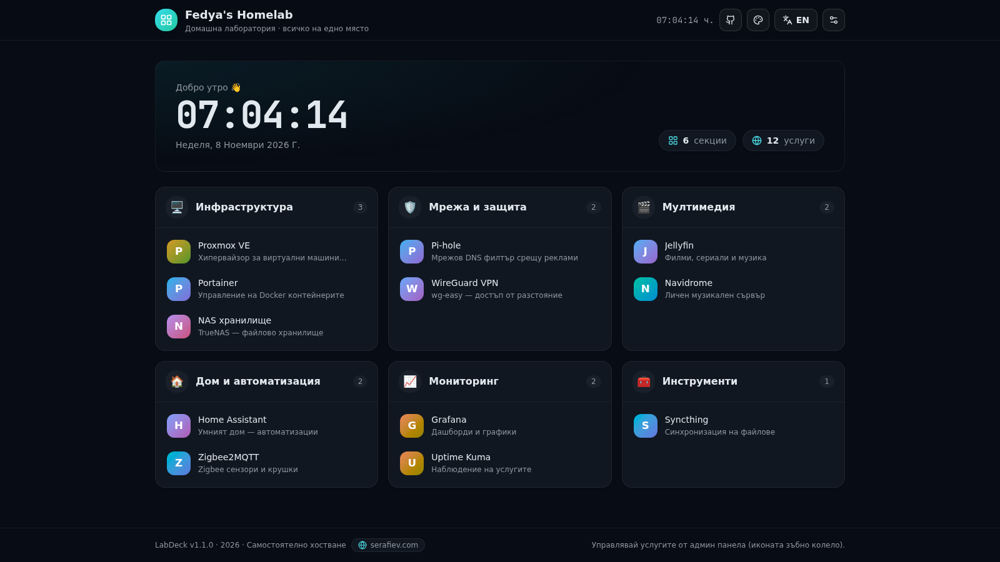
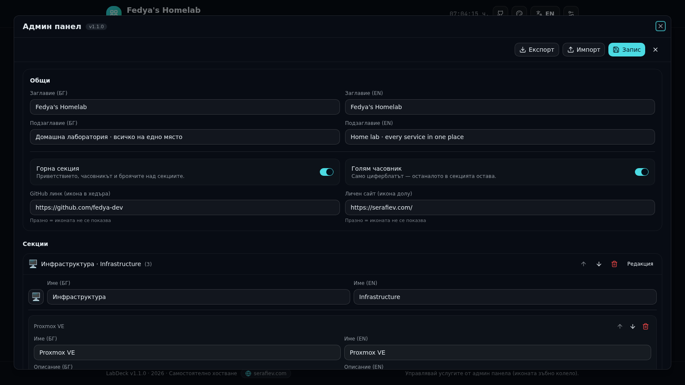
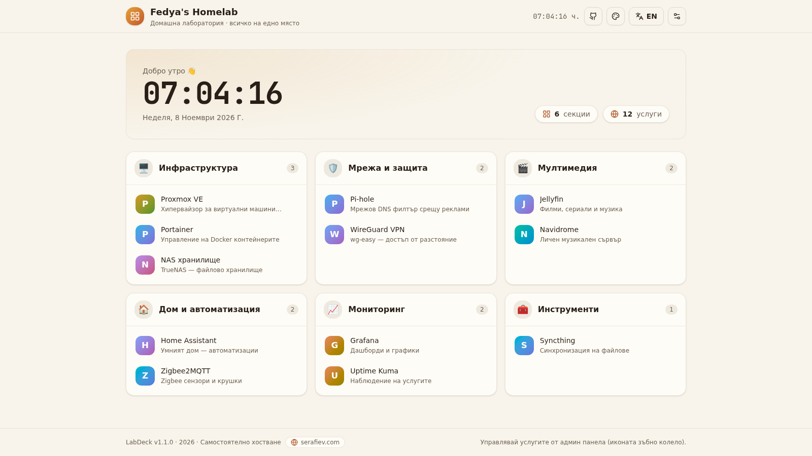

<div align="center">


# LabDeck

**A self-hosted home lab dashboard. Every service in one place.**

Табло за домашна лаборатория — всички услуги на едно място

[](https://nextjs.org)
[](https://www.typescriptlang.org)
[](https://tailwindcss.com)
[](docker-compose.yml)
[](LICENSE)

</div>



LabDeck turns a spare server into a clean launchpad for your home lab: group
Proxmox, Jellyfin, Home Assistant, Pi-hole and everything else into sections,
let the app fetch each service's favicon automatically, and manage it all from
a built-in admin panel — no YAML editing required.

Configuration lives in a single JSON file (or the admin panel), the whole
state is one Docker volume, and the image is a ~200 MB multi-stage build that
runs on any x86-64 or ARM64 host.

## ✨ Features

- **Sections & services** — group services with emoji, bilingual names and
  descriptions; reorder everything from the admin panel.
- **Automatic favicons** — each card resolves its icon from the service's
  `favicon.ico`, HTML `<link rel="icon">`, DuckDuckGo or Google S2, then caches
  it on disk. Unreachable services fall back to a colored letter avatar.
- **Admin panel** — full CRUD for sections and services, import/export JSON,
  unsaved-changes guard, optional password protection.
- **Hero widgets** — greeting, big clock, localized date and section/service
  counters; both the clock and the whole hero section can be disabled from the
  admin panel.
- **5 themes** — Midnight, Neon Cyber and Aurora (dark), Nordic Light and
  Paper (light), all built on OKLCH design tokens.
- **Bilingual UI** — Bulgarian and English everywhere, switchable per visitor,
  remembered in `localStorage`.
- **File-based config** — one `data/dashboard.json`, atomically written,
  trivially versionable and scriptable.
- **Self-contained** — Dockerfile (multi-stage, standalone output),
  `docker-compose.yml` with healthcheck, and a rotation-capable backup script.

## 🚀 Quick start

```bash
git clone https://github.com/fedya-dev/labdeck.git
cd labdeck

# optional: protect the admin panel
cp .env.example .env
nano .env                      # ADMIN_PASSWORD=…, LABDECK_PORT=3000

docker compose up -d --build
```

Open **http://<server-ip>:3000**. The first build takes a few minutes; every
start after that is instant.

Prefer a zip? Grab `labdeck.zip` from the releases, then:

```bash
unzip labdeck.zip -d labdeck && cd labdeck
docker compose up -d --build
```

### Updating

```bash
git pull                        # or unzip the new release
docker compose up -d --build
```

Your configuration (`data/`), `.env` and backups are never touched by an
update. If you update from a zip, extract without overwriting your data:

```bash
unzip -o labdeck.zip -d labdeck -x "data/*"
```

**Verify which build is actually running:**

```bash
curl -s http://localhost:8182/api/health
# → {"ok":true,"app":"LabDeck","version":"1.1.2",...}
```

The version is also shown in the admin panel header and in the footer. If it
does not match the release you just deployed, the container is still running
the old image — rebuild with `docker compose up -d --build` and hard-refresh
the browser (Ctrl+Shift+R).

**"The container name /labdeck is already in use"?** An old container from a
previous deployment still holds the name (typically after extracting a new
release into a different folder). Remove it once and start again:

```bash
docker rm -f labdeck             # one-time cleanup of the stale container
docker compose up -d --build
```

Since v1.1.1 `docker-compose.yml` no longer pins `container_name`, so Compose
names the container `<folder>-labdeck-1` and this conflict cannot happen again.

### Non-Docker

Requires Node.js 20+ or Bun 1.2+:

```bash
bun install
bun run build
bun run start          # http://localhost:3000
```

## ⚙️ Configuration

All settings come from environment variables (`.env`) and `data/dashboard.json`
(admin panel edits write back to the file atomically).

| Variable         | Default          | Description                                            |
| ---------------- | ---------------- | ------------------------------------------------------ |
| `ADMIN_PASSWORD` | *(empty)*        | Admin panel password. Empty = no protection (LAN only). |
| `LABDECK_PORT`   | `3000`           | Host port published by Docker.                         |
| `TZ`             | `Europe/Sofia`   | Container time zone (clock, greeting, logs).           |

Services are defined in `data/dashboard.json`. Example entry:

```json
{
  "id": "svc-jellyfin",
  "name":  { "bg": "Jellyfin", "en": "Jellyfin" },
  "description": { "bg": "Филми и сериали", "en": "Movies and shows" },
  "url": "http://192.168.1.30:8096",
  "icon": ""
}
```

`icon` accepts an explicit image URL; leave it empty and LabDeck fetches the
favicon of `url` automatically (disk-cached in `data/favicons/`, 5-minute
negative cache for hosts without one).

## 🛡️ Admin panel

The gear icon in the header opens the panel (password prompt when
`ADMIN_PASSWORD` is set):

- edit title, subtitle, hero visibility (whole section / just the clock) and
  header/footer links (GitHub, personal site);
- add, edit, reorder and delete sections and services;
- import/export the configuration as JSON;
- every change is validated with Zod before it reaches disk.

Session auth uses an HMAC-signed cookie; there is no account system by design.



## 💾 Backups

Everything important lives in `data/`. Create a rotated backup with:

```bash
./backup.sh                      # → backups/labdeck-backup-<ts>.tar.gz
BACKUP_KEEP=30 ./backup.sh       # keep 30 archives instead of 14
```

Daily at 3:00 via cron:

```
0 3 * * * cd /opt/labdeck && ./backup.sh >> backups/backup.log 2>&1
```

Restore: `tar -xzf backups/labdeck-backup-<ts>.tar.gz -C .`

## 🎨 Themes & languages

Five themes ship out of the box — switch from the palette icon in the header.
Colors are OKLCH design tokens in `src/app/globals.css`, so adding your own
theme is a matter of copying one `[data-theme]` block. The interface is fully
Bulgarian/English; strings live in `src/lib/i18n.ts`.



## 🧱 Project structure

```
src/app/                 page + API routes (config, auth, favicon, health)
src/components/          dashboard UI (header, hero, grid, admin panel, …)
src/lib/                 types, Zod schema, config store, i18n, auth
data/dashboard.json      your configuration (Docker volume)
data/favicons/           cached favicons
Dockerfile               multi-stage build → standalone Node 22 runtime
docker-compose.yml       service, volumes, healthcheck, env plumbing
backup.sh                rotated tar.gz backups of data/
```

## 🔒 Security notes

- Designed for a trusted LAN. If you expose it, set `ADMIN_PASSWORD` and put
  it behind a reverse proxy with TLS.
- The favicon resolver only follows `http(s)` URLs, caps responses at 512 KB
  and times out after 2.5 s per source.

## 📄 License

[MIT](LICENSE) — free to use, modify and self-host.

---

## 🧭 Ръководство на български

Практично ръководство — всичко, което трябва на всеки ден.

### Инсталация от нулата (GitHub → работещо табло)

```bash
git clone git@github.com:fedya-dev/labdeck.git
cd labdeck
echo "LABDECK_PORT=8182" > .env        # избери СВОБОДЕН порт на сървъра
mkdir -p data backups
chown -R 1000:1000 data backups        # контейнерът записва като uid 1000
docker compose up -d --build           # 1–3 минути за първи строеж
```

Отвори `http://<ip-на-сървъра>:8182`. Проверка: `curl -s localhost:8182/api/health`
→ `{"ok":true,"app":"LabDeck","version":"…",…}`.

### Смяна на порта

```bash
nano .env                              # смени реда LABDECK_PORT=
docker compose up -d                   # без --build — сменя се само средата
```

### Парола за админ панела

```bash
echo "ADMIN_PASSWORD=МоятаПарола" >> .env   # ако редът липсва
nano .env                                   # ако редът вече съществува
docker compose up -d
```

- Липсващ или празен `ADMIN_PASSWORD` = панелът е без защита (само доверена LAN).
- След смяна на паролата влизаш в панела наново с новата.
- Паролата живее в `.env` — този файл никога не се качва в git и не се пипа
  от обновяване.

### Обновяване

```bash
git pull && docker compose up -d --build
```

`data/`, `.env` и `backups/` никога не се засягат от обновяване.

### Резервно копие

```bash
./backup.sh                            # → backups/labdeck-backup-<време>.tar.gz
```

### Чести проблеми

| Проблем | Причина | Решение |
| --- | --- | --- |
| `port is already allocated` | портът е зает (напр. Grafana на 3000) | смени `LABDECK_PORT` в `.env` → `docker compose up -d` |
| Записът не пази секциите/услугите | `data/` не е собственост на uid 1000 | `chown -R 1000:1000 data backups` → `docker compose restart` |
| Показва се стара версия | кеш на браузъра или стар образ | `Ctrl+Shift+R`; провери `/api/health`; при нужда `docker compose up -d --build` |
| `container name "/labdeck" is already in use` | стар контейнер от предишен деплой | `docker rm -f labdeck` (от v1.1.1 вече не може да се случи) |
